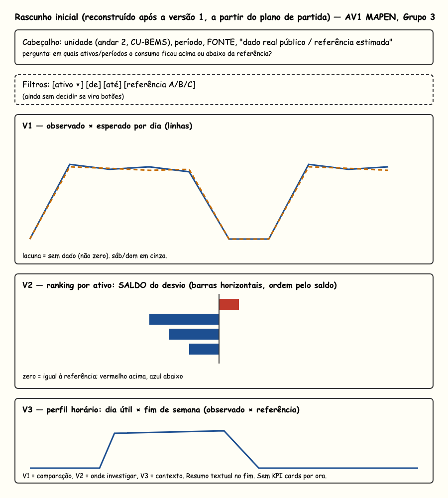
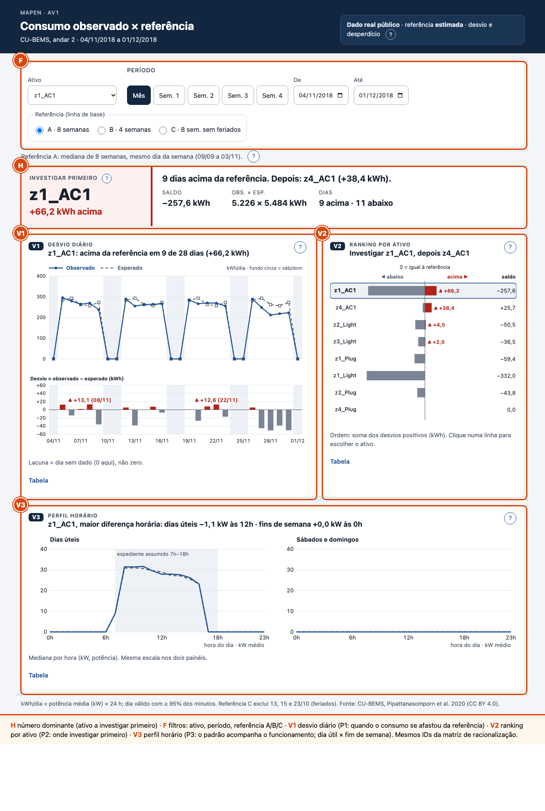

# Identificação e recorte

| | |
|---|---|
| **Grupo / projeto** | Grupo 3 · MAPEN/MAPPEN (Cesar School, BD e IA) |
| **Integrantes** | Alex Távora, Eloiza Merkl, Jéssica Freitas, João Rietra, Lucca Lima, Nathália Monteiro, Wellen Mariah Lisba (lista do relatório SR1) |
| **Versão e localização** | versão 1.0 do pacote, 08/10/2026. Pasta `av1-grupo-3-mapen/` (índice na seção 18 e no `LEIA-ME.md`) |
| **Painel** | `dashboard/index.html` (abre direto no navegador, sem servidor) |

> **Registro do grupo:** as seções 12 (teste de leitura, com participante anonimizado) e 16 (contribuições) foram preenchidas pelo grupo no Google Docs e trazidas para este arquivo. Ainda falta o grupo registrar **quem aplicou o teste, quando e quanto durou**, e cada integrante **confirmar a própria linha** da seção 16. Nada foi inventado para esses itens.

# 1. Estado atual comprovado

**O que existe e onde verificar** (repositório `jhlr/mapen`, privado):

- Carga e validação de leituras por equipamento, em camadas (domínio, aplicação, infraestrutura, interface), com testes automatizados (`tests/`).
- Linha de base e alertas sobre dado real público: sazonal-ingênuo de 168 h (mesma hora da semana anterior) e LightGBM; `data/m3/relatorio_m3.md`, `docs/m3_notas.md`. Foram gerados 182 alertas (128 por z-score, 54 por LightGBM); **todos são candidatos, nenhum corroborado** (não há rótulo real).
- API autenticada e dashboard Next.js (`dashboard/`, `docs/dashboard_notas.md`), simulador de sensor com comandos assinados (`docs/simulador_notas.md`).
- Esta AV1: pipeline reprodutível, painel estático e evidências em `av1-grupo-3-mapen/`.

**O que ainda é hipótese, proposta ou dependência:**

- Não existe base de consumo de cliente do grupo. Nenhuma tomada IoT foi instalada; não há medição própria.
- Economia: o experimento antes×depois usa redução **sintética** injetada em dado real; nenhum método atingiu a tolerância de ±3 pp (baseline 7/19 equipamentos, grupo-controle 12/19). Nenhum número de economia é prometido.
- Desligamento remoto fica desativado até passar o checklist de segurança.

**Mudanças em relação ao SR1 e justificativa.** Segundo o enunciado do professor (Guia p. 11; ficha 07 p. 8), o relatório SR1 Innovation (p. 7–10) registra a mudança do MAPEN para o **MAPPEN**: tomadas IoT, monitoramento e aconselhamento, com aprofundamentos previstos; a apresentação `MAPEN_Apresentacao_PME` (slides 8–11) usa dados existentes e linha de base. Esses arquivos (S4 a S6 do Guia) **não estavam disponíveis para quem redigiu este rascunho**. O que foi consultado: o rascunho `RELATÓRIO MAPEN.md` (17/08/2026) e `MAPEN-SR1.pptx`, ambos ainda sobre **perdas na distribuição** (energia distribuída × consumida, redflags EPE/ANEEL), e o plano de pivô do repositório (`docs/plano-pivo-iot-assinatura-2026-10-01.md`). Esta AV1 usa **somente a pergunta da PME** (desvio de consumo por equipamento) e não mistura a antiga perda de distribuição.

**Versão de escopo adotada.** Protótipo analítico, sem IoT, sem controle de equipamentos, sem previsão.

**Entrada escolhida (exigida pela encomenda):** histórico existente em CSV, de **dado real público** (CU-BEMS). Não são leituras IoT do grupo (não existem) nem uma simulação: as leituras reais de um prédio público fazem o papel das que a tomada IoT faria. Formato de uma linha e a mensagem equivalente do MAPPEN: `dados/dicionario.md`.

# 2. Decisão e perguntas

> **A pessoa que gerencia uma unidade (um andar de prédio comercial) consulta o painel toda semana para decidir quais ativos e quais dias investigar quando o consumo se afasta da referência, no contexto de um andar com 8 ativos monitorados (ar-condicionado, iluminação, tomadas).**

| ID | Pergunta analítica | Ação apoiada | Fonte candidata |
|---|---|---|---|
| P1 | Quando o consumo observado se afastou da referência esperada, e em que sentido? | Escolher dias para checar ocupação, agenda e operação | `base_diaria.csv` (kWh/dia) |
| P2 | Em quais ativos o excesso acumulado é maior? | Definir a ordem de investigação entre ativos | `base_diaria.csv` agregada por ativo |
| P3 | O padrão ao longo do dia acompanha o funcionamento esperado (dia útil × fim de semana)? | Distinguir uso fora do expediente de desvio real | `base_horaria.csv` (kW por hora) |

- **Período e unidade de análise:** 04/11 a 01/12/2018 (28 dias), andar 2 do CU-BEMS, 8 ativos, grão ativo × dia (P1, P2) e ativo × hora (P3).
- **Ativos do recorte:** Recorte de 8 dos 24 equipamentos do andar 2: cobre as quatro zonas (z1 a z4) e os três tipos de carga (ar-condicionado, iluminação e tomadas) e mantém `z4_Plug`, que nunca consome, de propósito, como caso de denominador zero. Os outros 16 ficaram fora e o motivo individual da escolha não foi registrado, então os 8 não são uma amostra estatística do andar e os achados não se generalizam para ele.
- **Fica fora:** IoT, controle de equipamentos, previsão, economia e perdas de distribuição. Estimativa monetária também fica fora; se um dia for feita, será a soma do desvio positivo × tarifa do intervalo, como cenário parcial que pode não representar a fatura.
- **Conclusão que ainda não podemos sustentar:** que um desvio seja desperdício, ou que exista economia realizável. O painel só diz onde investigar.

# 3. Pedido de dados faltantes

| Dado/campo | Por que é necessário | Quem pode fornecer | Prazo interno e alternativa |
|---|---|---|---|
| Leituras por equipamento de uma unidade real, ≥ 8 semanas, intervalo ≤ 1 h | Substituir o dado público por observação do cliente | Gestor da unidade piloto (a definir; hoje não há cliente) | A combinar com o grupo. Alternativa: seguir com CU-BEMS rotulado como público |
| Calendário operacional e feriados da unidade | Separar consumo fora do expediente de consumo dispensável (hoje inferido dos dados) | Gestor da unidade | A combinar. Alternativa: feriados tailandeses de 2018, conferidos nos próprios dados (consumo zero em 13, 15 e 23/10) |
| Identificação das cargas essenciais | Evitar tratar carga essencial como desvio | Gestor / manutenção | A combinar. Alternativa: nenhuma carga marcada como essencial nesta versão |
| Tarifa vigente | Só para estimativa monetária (não usada nesta entrega) | Fatura da distribuidora | Fora do escopo desta AV1 |

# 4. Encomenda específica do grupo

- **Trilha adotada no Guia:** Grupo 3 · MAPEN/MAPPEN, "fixar o recorte e explicar consumo observado versus referência" (Guia, p. 11; ficha 07, p. 8–10).
- **Evidência específica exigida e onde está:** ficha da linha de base (seção 7), conta independente (seção 7), comparação sob duas referências e calendários, com o ativo priorizado mudando ou não (seção 11).

# 5. Inventário e dicionário

Dicionário completo e regra de cada campo: `dados/dicionario.md`. Resumo:

| Fonte/versão | Grão/chave | Período e registros | Real, estimada ou simulada |
|---|---|---|---|
| CU-BEMS 2018Floor2.csv (figshare, DOI 10.6084/m9.figshare.11726517, arquivo 21350166, CC BY 4.0), recorte `recorte_minuto.csv.gz` | 1 linha/minuto, chave `Date` | 09/09 a 01/12/2018, 120.960 linhas | **Real** (público, não é do cliente) |
| `base_diaria.csv` | ativo × dia | 672 linhas (8 × 84) | Derivada (energia = potência média × 24 h) |
| `base_horaria.csv` | ativo × hora | 16.128 linhas | Derivada (média de potência por hora) |
| Referência (esperado) | ativo × dia da semana | janela anterior ao período avaliado | **Estimada** |

**Campos mínimos pedidos pela encomenda e onde estão:** unidade/ativo (`ativo`, andar 2); início e fim do intervalo (`Date` por minuto, `inicio_hora`); energia ou potência com definição (kW é potência média; kWh = kW × h); **horário operacional** (`expediente`: hipótese de 07h às 18h, seg a sex, sem feriados, **inferida do perfil e não informada por ninguém**); qualidade da leitura (`minutos_validos`, `valido`).

# 6. Registro de qualidade

Executado por `python codigo/av1_desvio.py --fonte <2018Floor2.csv>`; resultado em `evidencias/verificacoes_qualidade.json`.

| Verificação | Procedimento | Resultado | Decisão e impacto |
|---|---|---|---|
| Chaves/duplicidade | `Date` duplicado na janela | 120.960 linhas, **0** duplicados | Nenhuma ação |
| Ausência/códigos | Minutos sem valor por ativo; grade de 1 min | 0 timestamps faltando; 113 a 193 minutos vazios por ativo (de 120.960) | Dia só é válido com ≥ 95% dos minutos; energia usa a média dos minutos presentes |
| Tipos/unidades | `dtype`, sufixo do cabeçalho | `float64`, `(kW)` = potência média por minuto | kWh = kW × 24 h só como média diária; kW e kWh nunca misturados |
| Domínio/plausibilidade | negativos, máximo, ativos sem carga | 0 negativos; máx. 59,61 kW (`z1_AC1`); `z4_Plug` com máximo **0** | `z4_Plug` mantido de propósito como caso de denominador zero |
| Cobertura/junções | dias com < 95% dos minutos | 1 dia (19/09) em 6 ativos (iluminação e tomadas); 0 em `z1_AC1` e `z4_AC1` | Esse dia vira ausência, fica fora das medianas; não há junção |

**Linhas antes/depois das junções:** não há junções (tabela única). **Exclusões:** 6 pares ativo-dia em 19/09 (dentro da janela de referência, fora da janela avaliada). **Vínculo com o original:** `recorte_minuto.csv.gz` mantém os valores do arquivo original; só filtra colunas e período.

# 7. Fichas de indicador

**I1 · Desvio diário** (P1). Fonte `base_diaria.csv`, campo `kwh`. Fórmula: `desvio = observado − esperado` (kWh/dia); `desvio relativo = 100 × desvio / esperado`, **só se esperado > 0** (senão n/c, mostra-se o absoluto). Nulos: dia inválido vira lacuna, nunca zero. Limitação: o esperado é estimado.

**I2 · Soma dos desvios positivos, soma dos negativos e saldo** (P2). Σ dos desvios > 0 (ordena), Σ dos < 0 e a soma dos dois. O saldo permite compensação entre dias; por isso a ordem usa a soma dos positivos. Filtros: ativo, período e referência recalculam tudo.

**I3 · Perfil horário** (P3). Mediana, entre os dias do tipo (útil, fim de semana), da potência média por hora (kW), observado × referência. Mesma escala vertical nos dois painéis.

**Ficha da linha de base (referência).** Regra: mediana, por ativo, da energia diária (kWh) dos dias **com o mesmo dia da semana** numa janela anterior ao período avaliado (o intervalo avaliado nunca entra). Três variantes, que mudam uma hipótese cada:

| ID | Hipótese | Janela |
|---|---|---|
| A (principal) | 8 semanas, todos os dias | 09/09 a 03/11/2018 |
| B | só as 4 últimas semanas | 07/10 a 03/11/2018 |
| C | como A, sem feriados | 8 semanas, sem 13, 15 e 23/10 |

**Variáveis de contexto que a referência não controla:** ocupação e calendário letivo, temperatura externa e set-point do ar-condicionado, obras e manutenção, falhas de medição, mudança de uso do andar. O CU-BEMS tem sensores de temperatura por zona, que não foram usados. **Cargas essenciais:** nenhuma classificada (`carga_essencial` = não informado nos 8 ativos); a classificação cabe ao gestor (seção 3).

**Conta independente.** Refeita com `codigo/conta_independente.py` (somente biblioteca padrão, lê o CSV bruto, mediana por `statistics`; **não reaproveita código do pipeline**, como pede o Guia 4.4):

| Item | Valor |
|---|---|
| Caso | `z1_AC1`, segunda 12/11/2018, referência A |
| Entradas | segundas de 09/09 a 03/11: 324,89; 332,12; 266,85; 287,48; 279,77; **0,00 (15/10, feriado)**; 280,68; 317,88 kWh |
| Esperado (mediana) | 284,0763 kWh |
| Observado | 289,4012 kWh |
| Desvio | **+5,3248 kWh** |
| Exibido pelo pipeline | observado 289,4012; esperado 284,0763; desvio +5,3248 |
| Diferença | 0,00003 kWh (arredondamento) |

Segunda conferência: `z4_AC1`, 19/11, referência B: desvio +1,3021 kWh nos dois caminhos. Terceira, **cruzada**: `codigo/conferencia_cruzada.js` compara o cálculo do painel (JavaScript) com o do Python em 2.016 valores (3 referências × 224 ativo-dia × 3 grandezas): maior diferença 0,0001 kWh, 0 falhas.

# 8. Fichas de racionalização visual

## V1 · Desvio diário: quando o consumo se afastou da referência? (P1)

Pessoa que lê: gestor da unidade, semanal. Decisão: quais dias checar. Fonte `base_diaria.csv`, indicador I1. Grão ativo × dia, período e ativo pelos filtros.

| Decisão | Escolha | Por que serve à tarefa |
|---|---|---|
| Tipo de gráfico | Linhas (observado, esperado) + barras do desvio abaixo, mesmo eixo X | Trajetória no tempo e desvio juntos; o desvio em barras é lido por **posição em escala comum** (canal mais preciso, Cleveland & McGill) |
| Marca e canal | Linha com ponto = observado; tracejada com quadrado vazio = esperado; barra a partir do zero = desvio | Dois canais redundantes (estilo de linha e marcador) além da cor |
| Escala e referência | kWh/dia a partir de 0; eixo do desvio simétrico em torno de 0 | Linhas começam em zero, sem truncar; zero do desvio = igual à referência |
| Ordenação | Cronológica; lacuna onde falta dado | Ausência não vira zero |
| Cor e redundância | Azul = observado, cinza = esperado e abaixo, vermelho = acima **com ▲ e sinal +** | Nada depende só da cor |
| Título, unidade, rótulos | Título afirma o resultado ("acima da referência em 9 de 28 dias (+66,2 kWh)"); legenda direta; unidades nos eixos | Conclusão antes do detalhe |
| Informação de qualidade | Texto "Lacuna = dia sem dado"; fundo cinza = sáb/dom | Calendário visível |

- **Alternativa descartada:** mostrar só o consumo total diário (sem esperado). Esconde se o valor é alto ou baixo para aquele dia da semana; fim de semana parece "queda".
- **Pode concluir:** em quais dias o ativo ficou acima ou abaixo da referência e por quanto. **Não pode concluir:** que o excesso é desperdício; que a referência é "o consumo normal".
- **O que muda com os filtros:** ativo, período e referência refazem linhas, barras e título.
- **Descrição textual equivalente:** o título da vista, o resumo no `aria-label` e a tabela equivalente (botão "Tabela").

## V2 · Ranking por ativo: onde investigar primeiro? (P2)

Fonte `base_diaria.csv`, indicador I2, grão ativo.

| Decisão | Escolha | Por que serve à tarefa |
|---|---|---|
| Tipo de gráfico | Barras horizontais divergentes por ativo | Compara magnitudes por comprimento a partir do zero; nomes legíveis |
| Marca e canal | Direita (vermelho): soma dos positivos. Esquerda (cinza): soma dos negativos. Coluna "saldo" | Mostra a compensação sem escondê-la |
| Escala e referência | Mesma escala nas duas direções; zero rotulado "igual à referência" | Comparação justa entre acima e abaixo |
| Ordenação | **Pela soma dos desvios positivos**, do maior para o menor | É o que orienta onde investigar |
| Cor e redundância | Vermelho leva ▲ e valor; cinza fica sem rótulo | Funciona em tons de cinza |
| Título, unidade, rótulos | "Investigar `z1_AC1`, depois `z4_AC1`" (versão 3); na versão 4, o nome por extenso com o código ao lado (revisão 3); kWh em todos os valores | Resposta direta |
| Informação de qualidade | Ativo sem dado mostra "sem dado" | Não finge zero |

- **Alternativa descartada (e depois corrigida):** ordenar por **saldo**. Ver seção 9: a primeira versão fez isso e apontou o ativo errado.
- **Pode concluir:** a ordem de investigação sob a referência escolhida. **Não pode:** que o primeiro da fila "desperdiça mais".
- **O que muda com os filtros:** período e referência refazem soma e ordem; clicar numa linha escolhe o ativo da V1 e da V3.
- **Descrição textual:** título, `aria-label` e tabela com soma dos positivos, dos negativos, saldo, observado, esperado e dias válidos.

## V3 · Perfil horário: o padrão acompanha o funcionamento? (P3)

Fonte `base_horaria.csv`, indicador I3, grão ativo × hora.

| Decisão | Escolha | Por que serve à tarefa |
|---|---|---|
| Tipo de gráfico | Duas linhas por painel (observado contínua, referência tracejada), um painel para dia útil e outro para fim de semana | Mostra a forma do dia; separar o calendário evita comparar sábado com segunda |
| Marca e canal | Posição (hora × kW) | Canal mais preciso |
| Escala e referência | **Mesma escala vertical** nos dois painéis; 0 a máximo | Comparável entre painéis |
| Ordenação | Hora de 0 a 23 | Ordem natural |
| Cor e redundância | Azul contínua × cinza tracejada | Estilo de linha separa mesmo em cinza |
| Título, unidade, rótulos | Título com a maior diferença horária ("dias úteis −1,1 kW às 12h"); eixo "kW médio" | Potência e energia nunca se confundem |
| Informação de qualidade | Horas com < 45 minutos viram ausência; faixa cinza = expediente assumido (7h às 18h) | Sem interpolação; separa fora do expediente de dispensável |

- **Alternativa descartada:** um único gráfico de calor hora × dia. Mais denso, pior para comparar observado e referência.
- **Pode concluir:** se o ativo liga e desliga nos mesmos horários da referência. **Não pode:** que o uso fora do expediente seja dispensável (calendário ≠ necessidade).
- **O que muda com os filtros:** ativo e referência; o período avaliado é sempre o mês inteiro. Com "todos os ativos" a vista pede um ativo (mediana não soma).
- **Descrição textual:** título, `aria-label` e tabela hora a hora.

# 9. Revisão de vistas

Três revisões reais, cada uma com a imagem da versão anterior guardada em `evidencias/`.

**Revisão 1 · V2 por saldo → por soma dos desvios positivos** (`painel_versao1_inicial.png` → `painel_versao2_revisado.png`).

- **Problema detectado:** na versão inicial, as barras eram o **saldo** e a ordem pelo saldo. Resultado: `z4_AC1` (único com saldo positivo, +25,7 kWh) ficou no topo e `z1_AC1` ficou em **penúltimo** (saldo −257,6 kWh), embora tenha a maior soma de desvios positivos, +66,2 kWh em 9 dias. Dias abaixo da referência compensavam os dias acima. Havia também sobreposição de rótulos em `z1_Light`.
- **Mudança:** barras de positivos e negativos separadas, ordem pela soma dos positivos, saldo em coluna à parte, rótulos em coluna fixa.
- **Evidência:** `z1_AC1` passa de 7º para 1º; a sobreposição some. Verificado no navegador e no cálculo (soma dos positivos conferida contra o Python).

**Revisão 2 · painel inteiro, versão 2 → versão 3** (`painel_versao2_revisado.png` → `painel_versao3_final.png`), motivada por crítica de um integrante ("horroroso", "verboso") e pelas regras da apostila da disciplina:

- Sem número dominante e com síntese em parágrafo → bloco "Investigar primeiro" (um número, três de apoio) e títulos que afirmam o resultado.
- Desvio só implícito nas linhas → barras de desvio em escala comum (posição).
- Texto explicativo longo na tela → botões **?** que abrem a explicação sob demanda; a tela fica só com título, números e legendas de uma linha.
- Contrastes calculados (seção 13); fonte mínima de 12 px nos gráficos; ranking clicável e acessível por teclado.

**Revisão 3 · nomes legíveis e página de nomes** (`painel_versao3_final.png` → `painel_versao4_nomes.png`; também `nomes_pagina.png` e `painel_versao4_celular_375.png`).

- **Problema (retorno do grupo):** "um monte de nome feio, nenhum explicativo". Conferido no código: o painel mostrava só os códigos do dado (`z1_AC1`, `z1_Light`, `z1_Plug`...), e nada explicava zona, tipo (AC, Light, Plug) nem número; os botões **?** explicavam as contas, não os nomes.
- **Mudança:** o nome legível é derivado do código em um só lugar (`rotulos_ativos`, gravado em `dados.js`) e usado em todo o painel, com o código ao lado ("Ar-condicionado 1 · zona 1 (z1_AC1)"); a nova página `dashboard/nomes.html`, ligada no cabeçalho e abaixo dos filtros, explica o código, lista os 8 ativos e define cada termo (esperado, desvio, saldo, n/c, lacuna, expediente, kW × kWh). Os arquivos de dados não mudaram.
- **Verificado por nós:** 7 testes passam (2 novos, vermelhos antes); a conferência cruzada falha se faltar rótulo (8 falhas antes, 0 depois); 12 medições de rolagem horizontal (375, 768 e 1280 px) sem estouro nem erro de JavaScript.
- **Não verificado:** se um leitor externo entende os nomes sem ajuda (o teste da seção 12 não perguntou sobre eles). O significado de AC, Light e Plug segue a descrição do conjunto de dados no figshare, não o artigo completo.

# 10. Wireframe do dashboard

| Área | Conteúdo | Pergunta/decisão |
|---|---|---|
| Cabeçalho e contexto | Unidade, período, selo "dado real público · referência estimada · desvio ≠ desperdício" | Evita ler como cliente real |
| Filtros (F) | Ativo, período (Mês, Sem. 1 a 4, datas), referência A/B/C | Recortes e sensibilidade |
| Destaque (H) | Ativo a investigar primeiro, +kWh acima, saldo, observado × esperado, dias acima/abaixo | Decisão em 5 segundos |
| Vista principal (V1, desvio diário) | Linhas e barras de desvio do ativo escolhido | P1 |
| Vista de explicação (V2, ranking por ativo) | Ranking por ativo | P2 |
| Contexto (V3, perfil horário) | Perfil horário | P3 |
| Detalhe e limitações | Botões **?**, tabelas equivalentes, rodapé com fórmula e fonte | Rastreio |

- **Ordem de leitura:** conclusão (H) → comparação (V1) e prioridade (V2) → contexto (V3). Conclusão antes da evidência.
- **Filtros, valores iniciais e visuais afetados:** `z1_AC1`, mês inteiro, referência A; tudo recalcula (H, V1, V2, V3 conforme a regra de cada uma). A URL aceita `?ativo=&de=&ate=&ref=`.
- **Zero, ausência e erro:** período sem dado mostra mensagem e esconde as vistas; `esperado = 0` mostra n/c no relativo; dia inválido vira lacuna.
- **Fonte, atualização e simulação:** fonte e licença no rodapé; dado **real público**, nenhuma simulação neste painel.

# 11. Testes numéricos e de interação

| Caso | Entrada/filtros | Esperado | Obtido (e correção) |
|---|---|---|---|
| Recorte padrão | `z1_AC1`, 04/11 a 01/12, ref. A | Soma dos positivos do `z1_AC1` igual à do Python (66,2) | H: +66,2 kWh, 9 dias acima, saldo −257,6, observado 5.226 × esperado 5.484 kWh. Confere com o Python. |
| Segundo recorte | `z4_AC1`, 18 a 24/11, ref. B | Resumo recalculado só da semana | V1: acima em 5 de 7 dias (+10,4 kWh); H: `z1_AC1` +24,9 e `z4_AC1` +10,4. Os números mudam com os filtros. |
| Vazio / denominador zero | `z4_Plug` (esperado = 0) e período 10 a 20/12 (sem dados) | Relativo n/c; mensagem de "sem dados" e vistas ocultas | `z4_Plug`: "acima em 0 de 28 dias (0,0 kWh)" e legenda "Esperado = 0: desvio relativo n/c". Período vazio: "Sem dados no período 10/12/2018 a 20/12/2018". |

Imagens: `e4_recorte2_sem3_refB_z4AC1.png`, `e4_zero_z4Plug.png`, `e4_sem_dados.png`.

**Sensibilidade (premissa alterada) e impacto na decisão.** Soma dos desvios positivos (kWh), primeiros lugares:

| Período | A · 8 sem. | B · 4 sem. | C · sem feriados |
|---|---|---|---|
| Mês inteiro | **z1_AC1 66,2**; z4_AC1 38,4 | **z1_AC1 90,3**; z4_AC1 33,2 | **z1_AC1 55,5**; z4_AC1 36,8 |
| Semana 2 (11–17/11) | z1_AC1 12,72; z4_AC1 12,68 | z1_AC1 16,57; z4_AC1 11,00 | **z4_AC1 12,17**; z1_AC1 9,32 |
| Semana 4 (25/11–01/12) | z1_AC1 5,44; z4_AC1 2,17 | z1_AC1 9,29; z1_Plug 3,38 | **z4_AC1 2,05**; z1_AC1 2,04 |

- **Mês inteiro:** a prioridade **não muda** (`z1_AC1`, depois `z4_AC1`), mas o tamanho do excesso de `z1_AC1` varia de 55,5 a 90,3 kWh conforme a referência.
- **Semanas:** o ativo priorizado **muda** nas semanas 2 e 4 quando os feriados saem da referência (C). Na semana 2 a diferença sob A já é de 0,04 kWh, um empate técnico.
- **Causa:** feriados com consumo zero (13, 15 e 23/10) entram como segunda ou terça "normais" em A e B, puxam a mediana para baixo e **inflam** os desvios positivos, sobretudo em B, que tem só 4 semanas.
- **Consequência para a decisão:** a ordem de investigação por mês é robusta; a ordem **semanal** não é. Recomendação do painel: tratar o topo como candidato, olhar a referência C e confirmar com o calendário real da unidade.

**Segunda premissa: horário operacional.** Parcela do consumo fora do expediente (energia do mês, dias úteis fora do horário e fins de semana), sob três hipóteses:

| Hipótese de expediente | z1_AC1 | z1_Light | z1_Plug | z2_Light | z2_Plug | z3_Light | z4_AC1 |
|---|---|---|---|---|---|---|---|
| 07h–18h (adotada) | 0,0% | 2,6% | 12,8% | 2,9% | 9,7% | **37,1%** | 0,0% |
| 08h–17h | 3,4% | 11,2% | 18,1% | 11,2% | 15,0% | **47,9%** | 3,0% |
| 06h–20h | 0,0% | 0,4% | 10,5% | 0,2% | 8,0% | **26,6%** | 0,0% |

`z4_Plug` não consome. A hipótese mexe na **magnitude** (`z3_Light`: 26,6% a 47,9%), não na ordem: `z3_Light` segue o ativo com mais consumo fora do expediente. Isso é consumo **fora do expediente assumido**, não consumo dispensável: iluminação de corredor e tomadas podem alimentar cargas essenciais, e só o gestor classifica (seção 3). Reproduzir: `python codigo/av1_desvio.py` gera `base_horaria.csv` com a coluna `expediente`; a soma é feita sobre `kw` do mês avaliado.

# 12. Teste de leitura

**Participante (nome omitido, sem dados pessoais desnecessários):** 54 anos, doméstica, ensino fundamental II. **Não é cliente nem a usuária prevista do painel** (o usuário previsto é o gestor de uma unidade): pessoa consultada aleatoriamente, fora do grupo. **Quem aplicou, data e tempo aproximado: a registrar pelo grupo** (não constam do registro original).

| Tarefa | Resposta esperada | O que a participante fez |
|---|---|---|
| 1 · Encontre o período ou ativo a investigar primeiro | `z1_AC1`, mês inteiro, referência A | Identificou o período avaliado (04/11/2018 a 01/12/2018). **Não citou o ativo** a investigar primeiro |
| 2 · Compare dois recortes (por exemplo, mês inteiro × Sem. 3) e diga o que mudou | Mudança dos números ao trocar o filtro | Comparou os **dois painéis da V3** (dia útil × fim de semana), não dois recortes do filtro. Notou consumo maior entre 7h e 18h nos dias úteis e baixo e constante aos sábados e domingos |
| 3 · Explique de onde veio o esperado e por que o desvio não vira "desperdício" automaticamente; diga a diferença entre kW e kWh | Esperado = mediana de dias anteriores; desvio é pista, não prova; kW potência, kWh energia | Explicou o consumo maior nos dias de trabalho: "porque você usa computador, telefone… aparelhos que a gente liga na energia, o que não acontece nas empresas dia de sábado e domingo". **Não soube distinguir kW de kWh** (entende kWh como medida de energia e tempo). O registro não traz resposta sobre a origem do esperado nem sobre desvio ≠ desperdício |

**Leitura geral (registro do grupo):** achou os gráficos fáceis de entender, entendeu o período e as informações, achou fácil ver o pico "pela faixa em azul" (no painel o expediente é a faixa cinza e a linha azul é o observado; ela provavelmente se referiu à linha azul) e disse que as cores e os elementos ajudam. A dificuldade apontada foi kW × kWh.

**O que o registro mostra:** a leitura visual funcionou, mas ela não chegou ao resultado principal (qual ativo investigar primeiro), não fez a comparação de recortes pedida e não distinguiu kW de kWh.

**O que foi corrigido depois do teste:** **nada foi registrado pelo grupo como correção causada por este teste.** O verbete "kW e kWh" da `nomes.html` (revisão 3, seção 9) cobre a dificuldade, mas a página nasceu de outro retorno e não foi testada com um leitor externo. **A decidir pelo grupo:** refazer o teste com a versão 4 do painel.

**Limites do teste:** uma única sessão, com uma pessoa que não é o usuário previsto. Serve como indício sobre a leitura dos gráficos, não valida o painel com o gestor de uma unidade nem permite generalizar.

# 13. Acessibilidade

- **Contrastes calculados (WCAG 2.x)**, `evidencias/contrastes.json`: observado azul sobre branco 8,14; cinza da referência 5,98; vermelho 6,57; cinza das barras "abaixo" 3,77 (gráfico ≥ 3); texto 16,43; texto de apoio 7,56; anel de foco 6,39. Todos acima de 3:1 (gráficos) e 4,5:1 (texto).
- **Redundância da cor:** vermelho sempre com ▲ e sinal +; observado × esperado também por contínua × tracejada e ponto × quadrado; resumo textual no título de cada vista; **tabela equivalente** de cada vista.
- **Teclado e foco:** todos os controles têm foco visível; o ranking é navegável por Tab e Enter/Espaço; **?** com `aria-expanded` e Esc fecha. Filtros e botões de período com 44 px de altura; botões **?** com 28 px.
- **Não verificado:** auditoria automática (axe), leitor de tela real e teste do deuteranopia por simulador. O cálculo de contraste foi feito, mas "acessível" não foi atestado por ferramenta de terceiros.
- **Largura:** sem rolagem horizontal da página em 375 px (`scrollWidth` igual a `innerWidth`).

# 14. Resultados e limites

| Pergunta | Achado | Evidência no painel | Limitação |
|---|---|---|---|
| P1 | `z1_AC1` ficou acima da referência A em 9 de 28 dias (+66,2 kWh), com maior excesso de +13,1 kWh em 08/11; ficou abaixo em 11 dias e igual em 8 (fins de semana, desligado) | V1, barras de desvio | Referência estimada; semana atípica não é erro do equipamento |
| P2 | Ordem do mês: `z1_AC1` (+66,2), `z4_AC1` (+38,4), `z2_Light` (+4,5), `z3_Light` (+2,0). Os outros ficam ≈ 0 | V2 | Ordem semanal sensível à referência (seção 11) |
| P3 | `z1_AC1` segue a referência no dia útil (liga ~7h e desliga ~17h; maior diferença −1,1 kW às 12h) e fica a 0 kW no fim de semana | V3 | Duas medianas de potência; não prova eficiência |

- **A ação sustentada por esta versão:** investigar primeiro `z1_AC1`, depois `z4_AC1`, olhando os dias de maior excesso (08/11 e 22/11), e confirmar ocupação e agenda antes de qualquer decisão.
- **Hipótese rejeitada / interpretação corrigida:** "o ativo com maior saldo é o que mais merece atenção". Falso: o saldo esconde compensação (seção 9).
- **Próxima melhoria e dado de que depende:** substituir o CU-BEMS por leituras reais de uma unidade piloto e calendário operacional; incluir carga essencial.

# 15. Como reproduzir

- **Entrada e onde obter:** `dados/recorte_minuto.csv.gz` (já incluso). Original: figshare, DOI 10.6084/m9.figshare.11726517 (o artigo), arquivo `2018Floor2.csv` (id 21350166, cerca de 41 MB).
- **Ferramentas:** Python 3.11 ou mais novo (testado em 3.11, 3.12 e 3.13, com pandas 3.0.6) e Node (só para a conferência cruzada; testado com Node 22); Chrome para as capturas. O autor produziu os resultados com Python 3.14, pandas 3.0.5, numpy 2.5.2 e Node 26; as bases e os resultados saem idênticos nas versões testadas. Instalação: `pip install -r requirements.txt` (pandas, numpy, pytest), de preferência num ambiente virtual.
- **Atalho:** `python rodar.py` (no Windows, `py rodar.py` se `python` não for reconhecido; só biblioteca padrão) cria o `.venv`, instala as dependências, roda os quatro passos abaixo, confere cada resultado (`OK`, `FALHOU` ou `PULADO`) e abre o painel; `--sem-abrir` não abre o navegador. Testado do zero em Python 3.11, 3.12 e 3.13 no Linux; o tratamento de acentos e de fim de linha do Windows foi verificado por simulação, **não em uma máquina Windows**.
- **Ordem de execução**, na pasta `av1-grupo-3-mapen/` (saída esperada de cada passo no `LEIA-ME.md`):
  1. `python codigo/av1_desvio.py` (usa o recorte incluso; regrava bases e resultados com o mesmo conteúdo; com `--fonte <2018Floor2.csv>` refaz o recorte e a qualidade)
  2. `python codigo/conta_independente.py z1_AC1 2018-11-12 A` (desvio +5,3248 kWh, diferença 0,00003 kWh)
  3. `node codigo/conferencia_cruzada.js` (2.016 comparações, 0 falhas)
  4. `python -m pytest codigo -q` (7 testes passam)
- **Abre o dashboard:** `dashboard/index.html` (duplo clique ou `python -m http.server` na pasta `dashboard`).
- **Exportações e conferências:** `evidencias/` (resultados, qualidade, contrastes, capturas).

# 16. Contribuições

Registro feito pelo grupo no Google Docs; **cada integrante deve confirmar a própria linha**.

| Integrante | Decisão ou tarefa | Artefato/evidência | Revisão feita no trabalho do grupo |
|---|---|---|---|
| João Rietra | Recorte, pipeline, painel, conferências, rascunho deste relatório, gerenciamento de commits no GitHub | `codigo/`, `dashboard/`, `evidencias/` | Revisão técnica integrada e consistência do repositório |
| Alex Távora | Definição da linha de base, regras de agregação e cálculo dos indicadores de desvio | Seções de indicadores e regras da linha de base no relatório | Revisão da coerência matemática das fórmulas e hipóteses de desvio |
| Eloiza Merkl | Execução das verificações de qualidade, inventário de dados e construção do dicionário | Pasta `dados/`, `dicionario.md` e registros de qualidade | Revisão dos critérios de exclusão, nulos e tratamento de lacunas temporais |
| Jéssica Freitas | Redação do relatório de racionalização, estruturação textual, achados, limitações e próximos passos | Seções textuais do relatório principal | Revisão argumentativa, estrutural e gramatical da totalidade do relatório |
| Lucca Lima | Concepção das vistas visuais (V1, V2, V3), escolha de marcas, canais e alternativas descartadas | Fichas visuais e matriz de racionalização gráfica | Revisão da clareza visual, escalas e conformidade com as regras de acessibilidade |
| Nathália Monteiro | Análise do estado atual (alinhamento com SR1/MAPPEN) e planejamento do teste de leitura | Documentação de escopo, ficha de teste de leitura e estrutura do LEIA-ME | Revisão da fidelidade entre o percurso do projeto e as exigências da AV1 |
| Wellen Mariah Lisba | Organização do protótipo, desenho do wireframe e estruturação dos casos de teste (vazio e denominador zero) | Capturas de tela dos estados do painel e fichas de teste | Revisão da usabilidade do dashboard e coerência dos estados alternativos |

Os commits do repositório saem em nome de quem operou o Git (João Rietra); as contribuições dos demais integrantes constam nos documentos e revisões citados, sem commits próprios.

# 17. Declaração de IA e reutilização

- **Ferramentas:** Claude Code (Anthropic), usado por João Rietra, com as skills `apostila-avd` (regras de visualização extraídas da apostila da disciplina) e `data-visualization` (Anthropic).
- **Finalidade, saída aproveitada e mudanças:** esboço do pipeline Python, do painel (HTML/JS/SVG) e deste relatório. O que foi aproveitado está em `codigo/`, `dashboard/` e neste texto; o desenho final das vistas, as decisões de referência e a redação foram revisados e ajustados após críticas do integrante (seção 9).
- **Como verificamos:** testes unitários (7 casos, incluindo o desempate do ranking por nome do ativo e os rótulos dos ativos), conta independente em biblioteca padrão (diferença 0,00003 kWh), conferência cruzada JavaScript × Python (2.016 valores, diferença máxima 0,0001), execução do painel no navegador nos recortes da seção 11, contrastes calculados.
- **O que não conseguimos verificar:** teste de leitura com o usuário previsto (o teste feito foi com uma pessoa externa, não com um gestor) e com a versão 4 do painel, auditoria automática de acessibilidade e leitor de tela, e o calendário de feriados contra fonte oficial (só inferido dos dados e do conhecimento comum).
- **Reutilizado de terceiros:** dados do CU-BEMS, Pipattanasomporn et al. (2020), *Scientific Data* 7:241, licença CC BY 4.0. Material da apostila da disciplina (prof. Victor Hugo Wanderley Freire) como fonte de regras. Código do repositório MAPEN (M1 a M3) apenas como contexto, não reaproveitado neste painel.

# 18. Conferência da entrega

| Item | Onde |
|---|---|
| Relatório | `racionalizacao.pdf` (este arquivo) |
| Base e dicionário | `dados/` e `dados/dicionario.md` |
| Código/transformações | `codigo/av1_desvio.py` |
| Protótipo | `dashboard/index.html` |
| Rascunho inicial e captura anotada | `evidencias/rascunho_wireframe.png`, `evidencias/painel_versao3_anotado.png` |
| Matriz da racionalização | Anexo A (abaixo) |
| Dois recortes e caso sem dados | seção 11; `evidencias/e4_*.png` |
| Conta independente e conferência cruzada | seção 7; `codigo/` |
| Três fichas e revisão | seções 8 e 9 |
| Teste de leitura | seção 12 (uma participante; ver limites) |
| Sensibilidade | seção 11 |
| Contribuições e declaração de IA | seções 16 (cada integrante confirma a própria linha) e 17 |

**Índice sugerido do Grupo 3:** E1 recorte vigente (seções 1 e 2) · E2 base de consumo (5, 6, `dados/`) · E3 referência e contas (7) · E4 protótipo (10 e 11) · E5 racionalização (8, 9, anexo) · E6 validação e autoria (11 a 17).

# Anexo A · Evidência da racionalização do protótipo

**A. Ponto de partida.** Gestor de uma unidade, semanal, decide em que ativos e dias investigar um desvio de consumo. Estado: sem cliente nem sensor próprio, recorte de dado real público (CU-BEMS, andar 2, nov/2018).

**B. Rascunho e protótipo anotado.**

*Transparência: este rascunho foi redesenhado depois da versão 1 do painel, a partir do plano que a originou (V2 por saldo, sem destaque). Não é um papel feito antes de codar. Se o grupo tiver um rascunho à mão ou no Figma, ele deve substituir este arquivo.*

Versão 1 do painel: `evidencias/painel_versao1_inicial.png`. Versão 2 (revisada): `evidencias/painel_versao2_revisado.png`. Versão 3 (final): `evidencias/painel_versao3_final.png`.

**C. Matriz do raciocínio.**

| Elemento | Pergunta e decisão | Dado/indicador e cálculo | Escolha visual e motivo |
|---|---|---|---|
| V1 · desvio diário | P1 · quais dias checar | `base_diaria.csv`, `kwh`, I1: `desvio = observado − esperado`; relativo só com esperado > 0; recorte 04/11 a 01/12 | Linhas (observado, esperado) + barras de desvio em escala comum; vermelho com ▲ e sinal; lacuna ≠ zero |
| V2 · ranking por ativo | P2 · em que ativo começar | `base_diaria.csv` por ativo, I2: soma dos positivos (ordem), soma dos negativos, saldo | Barras horizontais divergentes, ordenadas pela soma dos positivos; saldo em coluna; rótulos sem depender de cor |
| V3 · perfil horário | P3 · se o padrão segue o funcionamento | `base_horaria.csv`, I3: mediana da potência média por hora, dia útil × fim de semana | Duas linhas por painel, mesma escala vertical, tracejada = referência |

**D. Alternativa e revisão.**

- **Alternativa descartada:** mostrar só o consumo total (V1) e ordenar por consumo ou por saldo (V2). Consumo total não separa "alto" de "alto para esse dia da semana"; o saldo apontou o ativo errado.
- **O que mudou entre rascunho e protótipo:** o rascunho previa V2 por saldo e uma tela sem destaque; a versão 1 seguiu isso e foi revista duas vezes (seção 9).
- **Evidência que motivou a mudança:** `z1_AC1` aparecia em penúltimo no ranking por saldo, com a maior soma de excessos (+66,2 kWh em 9 dias). Depois: sobrecarga de texto e falta de número dominante (crítica de integrante e regras da apostila).
- **Efeito esperado ou verificado na compreensão:** a prioridade do mês sai direto do destaque H e do ranking V2; a explicação detalhada fica sob **?**. **Verificado** por nós e por um teste de leitura com uma participante externa (seção 12), que achou os gráficos fáceis de ler mas não chegou ao ativo a investigar primeiro nem distinguiu kW de kWh; uma sessão não permite generalizar.

**E. Conclusão e limites.**

- **O protótipo permite investigar:** `z1_AC1` e `z4_AC1`, nos dias de maior excesso.
- **O dado ainda não permite concluir:** desperdício, economia, ou que a referência represente o normal; semana a semana a prioridade depende da referência.
- **Conferências que sustentam os números:** `codigo/conta_independente.py`, `codigo/conferencia_cruzada.js`, `codigo/test_av1_desvio.py`, `evidencias/resultados_python.json`.
